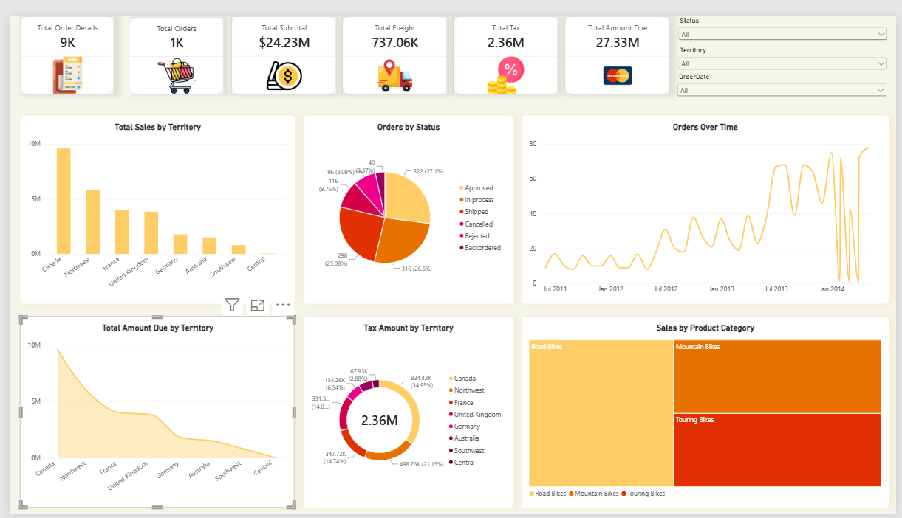
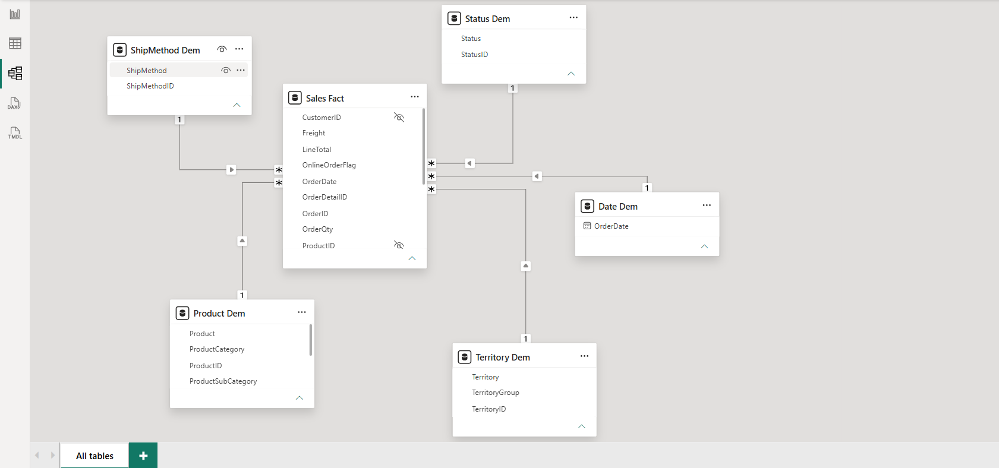

# Sales Analysis Dashboard | Power BI

## Project Overview
This project was developed as part of a Data Analysis course.

The main objective is to analyze sales data and present useful information through an interactive Power BI dashboard.

## Tools Used
- Microsoft Excel
- Microsoft Power BI

## Project Workflow

### 1. Data Preparation
Prepared and organized the raw sales dataset before starting the analysis.

### 2. Data Modeling
- Created Dimension Tables and a Fact Table.
- Designed a Star Schema data model.
- Established relationships between the tables.

### 3. Dashboard Development
Created an interactive dashboard containing:
- KPI Cards.
- Sales Analysis Charts.
- Order Status Analysis.
- Product Category Analysis.
- Territory Analysis.
- Interactive Slicers and Filters.

## Data Model
The project uses a Star Schema consisting of a central Fact Table connected to multiple Dimension Tables.

## Dashboard Preview

## Data Model Preview

## Project Files
- Dashboard: Power BI (.pbix) file.
- Dataset: Original Excel dataset (subject to sharing permission).
- Screenshots: Dashboard and Data Model previews.

---
Created as part of my Data Analysis learning journey.